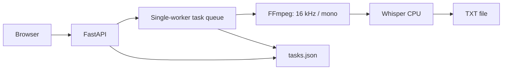

# ASR Web Lite

[日本語](README.md) · [简体中文](README.zh-CN.md) · **English**

A local audio transcription application with a browser interface. FastAPI and OpenAI Whisper connect audio uploads, task progress, and transcript downloads in one workflow.

**Python / FastAPI / Whisper / FFmpeg / JavaScript / PyInstaller**

## Problem

Running speech recognition should not require repeating terminal commands or sending recordings to an external transcription service. This application provides a browser interface while keeping audio processing on the local machine.

## Implemented features

| Capability | Implementation |
| --- | --- |
| Audio input | MP3, WAV, M4A; up to 500 MiB per file |
| Recognition language | Automatic detection, Japanese, Chinese, English |
| Model selection | Whisper tiny, base, small, medium; CPU inference |
| Task management | Queued, running, completed and failed states; progress and retry |
| Output | Transcript preview and UTF-8 `.txt` download |
| Distribution setup | macOS PyInstaller configuration; Windows launch/build scripts and Inno Setup configuration |

Documentation is available in three languages. The current application interface and most error messages are in Chinese.

## Interface and workflow


1. Start the application and open `http://127.0.0.1:8765`.
2. Select an audio file, model and recognition language, then start transcription.
3. Follow processing in the task list.
4. Download the transcript when the task completes.

## Architecture and tradeoffs



- **Local processing:** recordings and transcripts stay in local storage. Selecting an uncached model requires an initial download.
- **Sequential inference:** a single worker limits CPU and memory contention between transcription jobs.
- **JSON persistence:** task state is stored in a file to keep setup small for personal use.
- **Platform-specific implementations:** the macOS and Windows variants retain their own packaging and resource handling. Sharing duplicated code is a future improvement.

## Run from source

Requirements: Python **3.10–3.12**, plus `ffmpeg` and `ffprobe` on PATH. Installing dependencies and obtaining a model for the first time requires internet access.

### macOS

```bash
git clone https://github.com/zephyr-tmc/asr-web-lite.git
cd asr-web-lite
python3.12 -m venv .venv
source .venv/bin/activate
python -m pip install -r requirements.txt
python launcher.py
```

Install FFmpeg and add it to PATH first. Alternatively, launch with `scripts/start_macos.command`.

### Windows

```powershell
git clone https://github.com/zephyr-tmc/asr-web-lite.git
cd asr-web-lite\windows
scripts\start_windows.bat
```

The script detects Python 3.10–3.12 and prepares the environment and dependencies. Add FFmpeg to PATH or place its tools in `windows/bin/`.

## Package the application

See [build instructions](docs/BUILD.md). This repository contains source and build configuration; installers, model weights, and FFmpeg executables are excluded.

## Code map

| File | Responsibility |
| --- | --- |
| [`app/main.py`](app/main.py) | Uploads, validation, task API and execution queue |
| [`app/audio.py`](app/audio.py) | FFmpeg discovery and audio normalization |
| [`app/transcribe.py`](app/transcribe.py) | Model reuse, inference and progress callbacks |
| [`app/tasks.py`](app/tasks.py) | Task persistence and interrupted-task handling |
| [`app/static/`](app/static/) | Plain HTML, CSS and JavaScript interface |
| [`windows/`](windows/) | Windows resource paths and distribution configuration |

## Validation and limitations

Checks performed during repository preparation are recorded in [VALIDATION.md](docs/VALIDATION.md). No recognition-accuracy benchmark or Windows hardware validation result is claimed.

- CPU inference can be slow for long recordings.
- Recognition results may need correction.
- Intended for personal local use; authentication and multi-user features are not implemented.
- Uploaded files, output and task history are retained until manually removed. Source runs store them under each implementation's `data/` directory.

## Acknowledgements and licensing

Built with [OpenAI Whisper](https://github.com/openai/whisper), [FFmpeg](https://ffmpeg.org/), [FastAPI](https://github.com/fastapi/fastapi) and [PyInstaller](https://github.com/pyinstaller/pyinstaller). The project demonstrates application integration, rather than development of the underlying recognition model.

No license has been selected for the application's own code. Dependencies retain their respective licenses.
