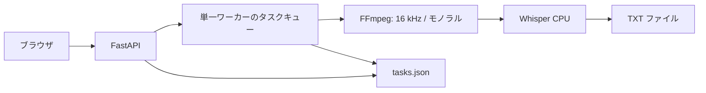

# ASR Web Lite

**日本語** · [简体中文](README.zh-CN.md) · [English](README.en.md)

録音ファイルをブラウザから文字に起こす、ローカル実行型の音声認識アプリです。FastAPI と OpenAI Whisper を組み合わせ、ファイルの選択から進捗確認、テキストの保存までを一つの画面にまとめています。

**Python / FastAPI / Whisper / FFmpeg / JavaScript / PyInstaller**

## 文稿ワークスペース

[文稿ワークスペース](docs/WORKSPACE.md)で文字起こし原稿やテキストを要約・構成分析できます。ユーザー指定の Chat Completions 互換サービスへ接続し、原文参照、編集、ローカル保存、Markdown 出力に対応します。ASR は引き続きローカル実行です。生成時のみ選択した原稿を設定先に送信します。API キーはプロセスのメモリに保持され、再起動後は再入力が必要です。

## 解決したい課題

音声認識モデルを利用するたびにコマンドを実行したり、録音を外部サービスへ送信したりする手間を減らすためのツールです。モデルをローカルで動かしながら、ブラウザ上の操作で文字起こしを行えます。

## 主な機能

| 機能 | 実装内容 |
| --- | --- |
| 音声入力 | MP3・WAV・M4A、1 ファイル最大 500 MiB |
| 言語指定 | 自動判定、日本語、中国語、英語 |
| モデル選択 | Whisper tiny・base・small・medium、CPU 推論 |
| タスク管理 | 待機・実行・完了・失敗の状態、進捗表示、再実行 |
| 結果出力 | テキストのプレビューと UTF-8 `.txt` ダウンロード |
| 配布用の構成 | macOS の PyInstaller 設定、Windows の起動・ビルドスクリプトと Inno Setup 設定 |

README は 3 言語です。現在のアプリ画面と主なエラーメッセージは中国語です。

## 画面と使い方


1. アプリを起動して `http://127.0.0.1:8765` を開きます。
2. 音声ファイル、モデル、認識言語を選び、文字起こしを開始します。
3. タスク一覧で処理状況を確認します。
4. 完了後にテキストをダウンロードします。

## 構成と設計上の選択



- **ローカル処理**：録音と文字起こし結果はローカルに保存します。未取得のモデルを初めて使うときはダウンロードが必要です。
- **単一ワーカー**：同時推論による CPU・メモリの競合を抑えるため、文字起こしは順番に実行します。
- **JSON による永続化**：小規模な個人利用向けに、データベースを導入せずタスクの状態を保存します。
- **OS ごとの配布構成**：macOS と Windows の実装を保持しています。重複するコードの共通化は今後の改善候補です。

## ソースから実行

必要なもの：Python **3.10–3.12**、`ffmpeg` と `ffprobe`。初回の依存関係・モデル取得にはインターネット接続が必要です。

### macOS

```bash
git clone https://github.com/zephyr-tmc/asr-web-lite.git
cd asr-web-lite
python3.12 -m venv .venv
source .venv/bin/activate
python -m pip install -r requirements.txt
python launcher.py
```

FFmpeg は事前にインストールして PATH に追加してください。`scripts/start_macos.command` による起動も可能です。

### Windows

```powershell
git clone https://github.com/zephyr-tmc/asr-web-lite.git
cd asr-web-lite\windows
scripts\start_windows.bat
```

スクリプトが Python 3.10–3.12 を検出し、仮想環境と依存関係を準備します。FFmpeg を PATH に追加するか、`windows/bin/` に配置してください。

## パッケージの作成

[ビルド手順](docs/BUILD.md)を参照してください。このリポジトリにはソースとビルド設定を収録しており、インストーラー、モデル重み、FFmpeg の実行ファイルは含めていません。

## コードの読みどころ

| ファイル | 役割 |
| --- | --- |
| [`app/main.py`](app/main.py) | アップロード、入力検証、タスク API、実行キュー |
| [`app/audio.py`](app/audio.py) | FFmpeg の検出と音声の標準化 |
| [`app/transcribe.py`](app/transcribe.py) | モデルの再利用、推論、進捗通知 |
| [`app/tasks.py`](app/tasks.py) | タスク状態の保存と中断時の処理 |
| [`app/static/`](app/static/) | フレームワークを使わないブラウザ UI |
| [`windows/`](windows/) | Windows 向けリソース探索と配布設定 |

## 検証と制約

公開用整理時の検証範囲は [VALIDATION.md](docs/VALIDATION.md) に記録しています。認識精度のベンチマークや Windows 実機での動作検証結果は、現時点では提示していません。

- CPU 推論のため、長時間の録音では処理に時間がかかります。
- 音声認識結果には誤りが含まれる場合があります。
- 個人のローカル利用を想定しており、認証や複数ユーザー向けの機能はありません。
- アップロード、出力、タスク履歴は自動消去されません。ソース実行時は各実装の `data/` に保存されます。

## 謝辞・ライセンス

[OpenAI Whisper](https://github.com/openai/whisper)、[FFmpeg](https://ffmpeg.org/)、[FastAPI](https://github.com/fastapi/fastapi)、[PyInstaller](https://github.com/pyinstaller/pyinstaller) を利用しています。モデル自体の開発を主張するものではありません。

アプリケーション独自コードのライセンスは未設定です。依存ソフトウェアには、それぞれのライセンスが適用されます。
