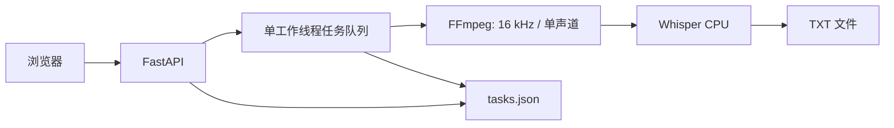

# ASR Web Lite

[日本語](README.md) · **简体中文** · [English](README.en.md)

在浏览器中完成录音转写的本地语音识别应用。使用 FastAPI 与 OpenAI Whisper，把文件选择、任务进度和文本下载放在同一界面中。

**Python / FastAPI / Whisper / FFmpeg / JavaScript / PyInstaller**

## 文稿总结与分析

新增[文稿工作室](docs/WORKSPACE.md)：从首页进入，导入文字或读取已完成的转写稿，配置本机／远程 Chat Completions 兼容模型，生成要点总结或结构分析。支持原文引用、音频回听、校对版本、成果编辑保存和 Markdown 导出。

ASR 继续在本机运行；仅在点击生成时把当前文稿发送到你配置的模型服务。密钥仅本次运行留存，重启需重新填写。此功能使用 SQLite 保存文稿和成果，不改变旧的 TXT 下载与 tasks.json。

## 解决的问题

让录音转写不必反复操作命令行，也不必把录音发送给外部识别服务。在保留本地模型处理方式的同时，为日常使用提供浏览器操作界面。

## 已实现功能

| 功能 | 实现内容 |
| --- | --- |
| 音频输入 | MP3、WAV、M4A，单文件上限 500 MiB |
| 识别语言 | 自动检测、日语、中文、英语 |
| 模型选择 | Whisper tiny、base、small、medium，使用 CPU 推理 |
| 任务管理 | 排队、运行、完成和失败状态，进度展示、重新执行 |
| 文本输出 | 转写预览和 UTF-8 `.txt` 下载 |
| 分发准备 | macOS PyInstaller 配置；Windows 启动、构建脚本及 Inno Setup 配置 |

README 提供中日英三语；当前应用界面及主要错误提示仍为中文。

## 界面与使用流程


1. 启动应用，打开 `http://127.0.0.1:8765`。
2. 选择音频文件、模型及识别语言，开始转写。
3. 在任务列表中查看处理状态。
4. 完成后下载文本。

## 结构与设计取舍



- **本地处理**：录音与转写文本保存在本机；首次使用未缓存模型时，需要联网下载模型。
- **顺序执行**：通过单工作线程减少并发推理对 CPU 和内存的争用。
- **个人资料保存**：ASR 任务沿用 JSON，文稿版本与生成成果使用内置 SQLite，无需部署数据库服务。
- **平台实现**：保留两平台启动与打包路径；文稿工作室服务和界面由两平台共用。

## 从源码运行

需要 Python **3.10–3.12**，以及可在 PATH 中找到的 `ffmpeg`、`ffprobe`。首次安装依赖及下载模型需要联网。

### macOS

```bash
git clone https://github.com/zephyr-tmc/asr-web-lite.git
cd asr-web-lite
python3.12 -m venv .venv
source .venv/bin/activate
python -m pip install -r requirements.txt
python launcher.py
```

请先安装 FFmpeg 并加入 PATH；也可使用 `scripts/start_macos.command` 启动。

### Windows

```powershell
git clone https://github.com/zephyr-tmc/asr-web-lite.git
cd asr-web-lite\windows
scripts\start_windows.bat
```

脚本检测 Python 3.10–3.12 并准备虚拟环境和依赖。请将 FFmpeg 加入 PATH，或将工具放入 `windows/bin/`。

## 构建安装包

参见[构建说明](docs/BUILD.md)。仓库只收录源码与构建配置，不包含安装包、模型权重或 FFmpeg 二进制文件。

## 代码阅读入口

| 文件 | 职责 |
| --- | --- |
| [`app/main.py`](app/main.py) | 文件上传、输入校验、任务 API 和执行队列 |
| [`app/audio.py`](app/audio.py) | FFmpeg 查找与音频标准化 |
| [`app/transcribe.py`](app/transcribe.py) | 模型复用、推理与进度回调 |
| [`app/tasks.py`](app/tasks.py) | 任务状态持久化与中断处理 |
| [`app/static/`](app/static/) | 原生 HTML、CSS、JavaScript 界面 |
| [`windows/`](windows/) | Windows 资源路径和分发配置 |

## 验证与限制

本次整理实际执行的验证见 [VALIDATION.md](docs/VALIDATION.md)。目前不提供识别精度基准或 Windows 实机验证结论。

- CPU 推理处理长录音时可能较慢。
- 识别结果可能有误，需要根据用途校对。
- 面向个人本地使用，未实现认证或多用户功能。
- 上传文件、文本及任务历史不会自动清理；源码运行时保存在各实现的 `data/` 中。

## 致谢与许可

使用 [OpenAI Whisper](https://github.com/openai/whisper)、[FFmpeg](https://ffmpeg.org/)、[FastAPI](https://github.com/fastapi/fastapi) 和 [PyInstaller](https://github.com/pyinstaller/pyinstaller)。项目展示的是应用集成，不将已有模型描述为自行开发。

应用自有代码尚未指定许可证；各依赖适用其原有许可证。
